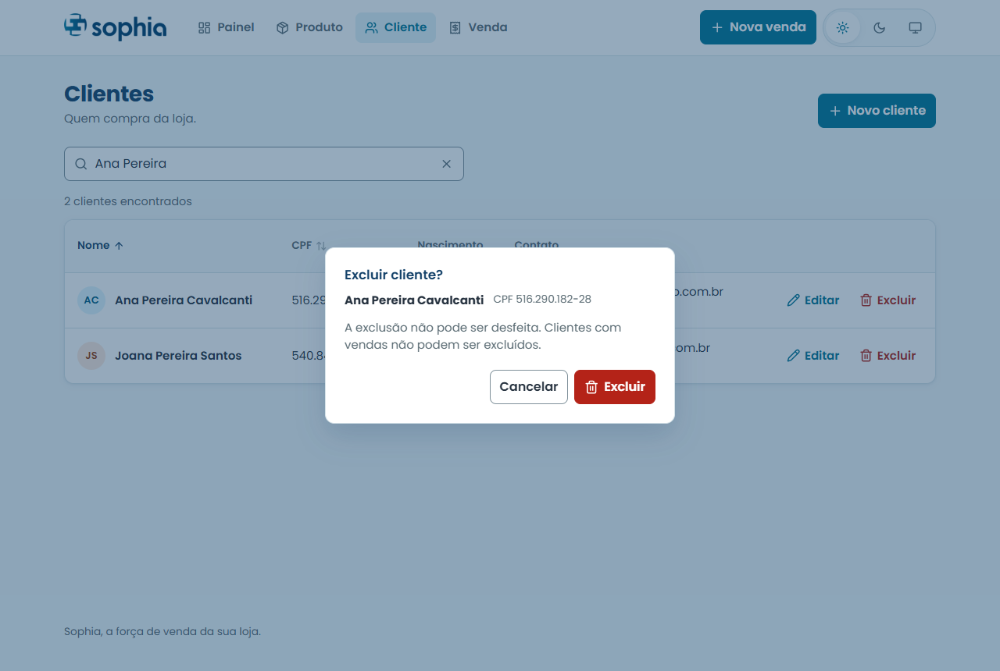
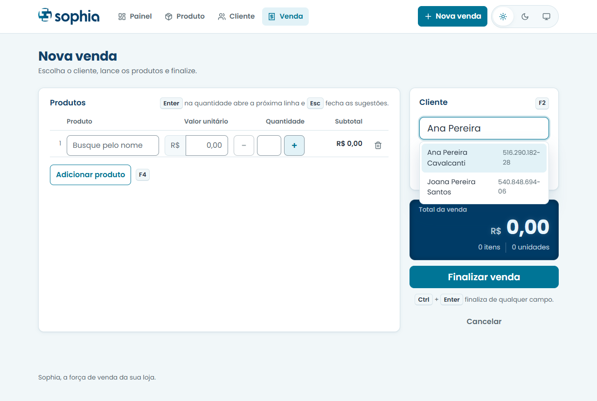
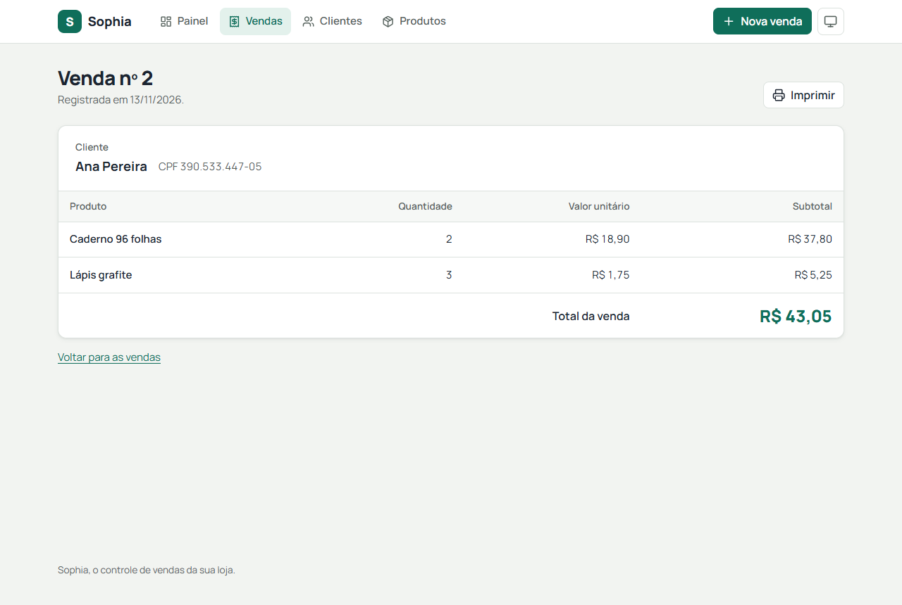
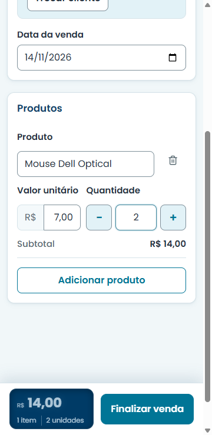
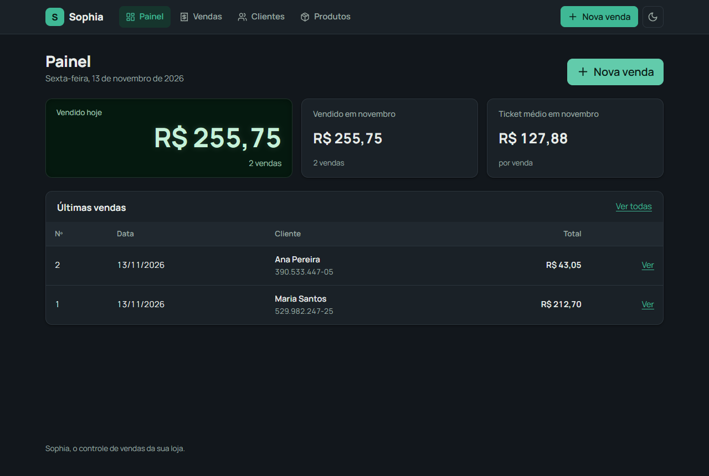

# Guia do usuário

Este guia é para quem opera o Sophia no dia a dia: cadastrar clientes e produtos e registrar
vendas no caixa. Para instalar e subir a aplicação, veja [Como executar](../README.md#como-executar).

- [1. Visão geral](#1-visão-geral)
- [2. Painel](#2-painel)
- [3. Clientes](#3-clientes)
- [4. Produtos](#4-produtos)
- [5. Registrar uma venda](#5-registrar-uma-venda)
- [6. Consultar vendas](#6-consultar-vendas)
- [7. No celular](#7-no-celular)
- [8. Tema claro e escuro](#8-tema-claro-e-escuro)
- [9. Atalhos de teclado](#9-atalhos-de-teclado)
- [10. Mensagens e o que fazer](#10-mensagens-e-o-que-fazer)

## 1. Visão geral

O menu do topo leva às quatro áreas do sistema:

| Menu | Para que serve |
|---|---|
| **Painel** | resumo do dia e do mês, gráficos e as últimas vendas |
| **Produto** | o que a loja vende e por quanto |
| **Cliente** | quem compra da loja |
| **Venda** | as vendas registradas, com filtro de período, e o comprovante de cada uma |

O botão **Nova venda**, no canto direito, abre o caixa de qualquer tela.

A ordem natural para começar é: cadastrar os produtos, cadastrar os clientes e só então
registrar as vendas.

## 2. Painel

É a tela inicial. Mostra:

- **Vendido hoje**: o total vendido no dia e a quantidade de vendas;
- **Vendido no mês** e **ticket médio** (o valor médio de cada venda no mês);
- **Últimos 7 dias**: uma barra por dia, com o dia de hoje em destaque; passe o mouse numa barra
  para ver o valor do dia. Dia sem venda não tem barra, e mesmo uma venda pequena aparece;
- **Mais vendidos do mês**: os cinco produtos com mais unidades vendidas;
- **Últimas vendas**: as mais recentes, com **Ver** para o comprovante e **Ver todas** para a lista.

## 3. Clientes

A lista mostra 25 clientes por página, com **Anterior** e **Próxima** no rodapé.

- **Buscar**: digite parte do **CPF** ou do **nome**; a lista se atualiza enquanto você digita.
  O **×** dentro do campo limpa a busca.
- **Ordenar**: clique no título da coluna **Nome** ou **CPF**; clique de novo para inverter. A
  seta ao lado do título mostra a ordem em uso.

### Cadastrar um cliente

1. Clique em **Novo cliente**. O cursor já começa no CPF.
2. Preencha os campos. Os marcados com **\*** são obrigatórios:

   | Campo | Obrigatório | Observação |
   |---|---|---|
   | CPF | sim | digite só os números; a máscara `000.000.000-00` entra sozinha. O CPF é conferido ao sair do campo e não pode estar cadastrado para outro cliente |
   | Nome | sim | até 150 caracteres; é o nome que aparece na venda e no cupom |
   | Data de nascimento | não | digite só os números (`12051990` vira `12/05/1990`); não pode ser uma data futura |
   | E-mail | não | precisa ter um formato válido, como `nome@exemplo.com.br`; o formulário confere ao sair do campo |
   | Telefone | não | com DDD (10 ou 11 dígitos); a máscara entra sozinha e o formulário confere ao sair do campo |

3. Clique em **Salvar**. Enquanto grava, o botão mostra **Salvando…**; depois, o aviso
   **Cliente cadastrado.** confirma.

Se o CPF já pertence a outro cliente, o sistema não grava, leva o cursor ao campo e avisa:

### Alterar ou excluir

Na lista, use o lápis (**Editar**) ou a lixeira (**Excluir**) na linha do cliente. A exclusão
pede confirmação numa janela sobre a própria lista e não pode ser desfeita. **Um cliente que já
tem vendas não pode ser excluído**, para não apagar o histórico.

## 4. Produtos

Funciona como o cadastro de clientes: lista em páginas, busca pelo nome enquanto se digita,
ordenação por **Nome** ou **Valor unitário** e exclusão com confirmação.

| Campo | Obrigatório | Observação |
|---|---|---|
| Nome | sim | não pode se repetir; maiúsculas, acentos e espaços a mais não contam ("Cafe Torrado" repete "Café Torrado") |
| Valor unitário | sim | maior que zero e até R$ 999.999,99, com até duas casas decimais: `1,75`, `1.250,00` ou `12.50` (ponto com uma ou duas casas também é decimal); formas ambíguas, como `1.2.3`, são recusadas assim que você sai do campo. `12.505` é lido como doze mil quinhentos e cinco, o campo mostra `12.505,00` e avisa com a nota do milhar |

O valor unitário é o preço **sugerido** no caixa: na venda ele pode ser ajustado. Mudar o
preço de um produto depois **não altera** as vendas já registradas.

**Um produto que já foi vendido não pode ser excluído.**

## 5. Registrar uma venda

A tela de venda foi pensada para ser operada só pelo teclado, como um caixa.

### Passo a passo

1. Clique em **Nova venda** (no topo de qualquer tela).
2. **Escolha o cliente** (atalho `F2`): digite parte do **CPF** ou do **nome**. As sugestões
   aparecem logo abaixo; use as setas para escolher e `Enter` para confirmar. O quadro
   **Cliente** mostra as iniciais, o nome e o CPF. Para mudar, use **Trocar cliente**.
   Se o cliente ainda não existe, a busca oferece **Cadastrar novo cliente**, que abre o cadastro
   numa nova aba sem perder a venda.

   

3. Confira a **Data da venda**. Ela já vem com a data de hoje e não aceita data futura.
4. **Lance os produtos** (atalho `F4` ou o botão **Adicionar produto**):
   - digite parte do nome do produto e escolha na lista com `Enter`;
   - o **valor unitário** vem preenchido com o preço do cadastro e pode ser ajustado;
   - informe a **quantidade**, até 99.999 por item (ou use os botões **−** e **+**), e pressione
     `Enter`: o sistema abre a próxima linha para o próximo produto;
   - valor mal escrito avisa ao sair do campo: **Valor inválido. Use 12,50 ou 1.250,00.**
   - quando o valor tem ponto e não tem vírgula, e depois do ponto vêm três algarismos (`12.505`,
     `1.250`), o ponto é lido como separador de milhar. Enquanto você digita, o campo mostra uma
     nota, sem bloquear: **Lido como R$ 12.505,00: o ponto separa o milhar. Para centavos, use a
     vírgula.** Se a intenção era centavos, escreva com vírgula (`12,50`). A nota some assim que o
     valor deixa de ser lido como milhar. Vale também no cadastro de produto.
5. Acompanhe os totais:
   - o **subtotal** de cada linha (quantidade × valor unitário);
   - o **Total da venda** no visor, com o número de itens e de unidades.
6. Para tirar um produto, use a **lixeira** no fim da linha. Removeu por engano? Clique em
   **Desfazer** no aviso **Produto removido.**, que fica alguns segundos na tela: a linha volta
   com o mesmo produto, valor e quantidade.
7. Clique em **Finalizar venda** ou pressione `Ctrl` + `Enter` (funciona com o cursor em
   qualquer campo). O botão mostra **Registrando…** e não aceita um segundo clique.

Linhas deixadas em branco são descartadas ao finalizar. Se faltar algo, a venda não é
gravada e a mensagem aparece no campo que precisa de correção; o que já foi digitado
continua na tela.

O mesmo produto não pode aparecer em duas linhas da mesma venda: escolher de novo um produto já
lançado soma 1 à quantidade da linha existente, e o caixa avisa, por exemplo, **Caneta azul já
estava na venda: quantidade somada na linha 1.**

Os avisos de erro somem assim que o problema é resolvido: escolher o cliente apaga
**Selecione o cliente.**, e lançar um produto apaga **Lance ao menos um produto na venda.**

Sair da tela com produtos lançados (pelo menu, por exemplo) pede confirmação, para a venda não
se perder sem querer. **Cancelar** sai da tela sem gravar nada.

### Depois de finalizar

O sistema mostra o comprovante da venda com o aviso **Venda registrada.**: número da venda,
data, cliente (nome e CPF), cada produto com quantidade, valor unitário e subtotal, e o
total da venda.

- **Imprimir** gera uma versão do comprovante própria para papel;
- o botão **Nova venda**, no topo, abre o caixa vazio para o próximo cliente.

Os totais são sempre recalculados pelo sistema na gravação: o que fica registrado é a conta
feita a partir dos itens.

## 6. Consultar vendas

O menu **Venda** lista as vendas em páginas de 25, das mais recentes para as mais antigas, com
número, data, cliente, quantidade de itens e total. **Ver** abre o comprovante.

- **Período**: preencha **De** e **Até** e clique em **Filtrar**, ou use os atalhos **Hoje**,
  **7 dias** (a quantidade de dias pode ser configurada) e **Mês**. **Todas** tira o filtro.
- **Ordenar**: clique em **Data** ou em **Total** para ordenar por essas colunas.

Vendas registradas não são alteradas nem excluídas: são o histórico da loja.

## 7. No celular

Todas as telas funcionam a partir de 360 pixels de largura, sem rolagem lateral. No caixa:

- o **total** e o botão **Finalizar venda** ficam numa barra fixa no rodapé, sempre visíveis;
- a quantidade tem botões **−** e **+** grandes, próprios para o toque;
- as listas mostram só as colunas essenciais; o resto aparece abaixo do nome, inclusive o
  número e a data da venda na lista de vendas.

## 8. Tema claro e escuro

No computador, a chave ao lado de **Nova venda** tem três posições: **sol** (claro), **lua**
(escuro) e **monitor** (automático, que acompanha a configuração do computador). Ela também pode
ser operada pelo teclado, com as setas. No celular, a mesma escolha fica num botão com menu.

A escolha fica guardada neste navegador.

## 9. Atalhos de teclado

Valem na tela de venda:

| Tecla | O que faz |
|---|---|
| `F2` | vai para a busca de cliente (ou troca o cliente escolhido) |
| `F4` | vai para o próximo produto em branco, abrindo uma linha se precisar |
| `↑` `↓` | navegam pelas sugestões de cliente ou de produto |
| `Enter` | confirma a sugestão; na quantidade, abre a próxima linha |
| `Esc` | fecha as sugestões; com as sugestões já fechadas, se a busca foi aberta pelo `F2`, devolve o cliente que estava escolhido |
| `Ctrl` + `Enter` | finaliza a venda |

## 10. Mensagens e o que fazer

| Mensagem | O que significa | O que fazer |
|---|---|---|
| Informe o CPF. / Informe o nome. | campo obrigatório vazio | preencha o campo |
| CPF inválido. | os dígitos verificadores não conferem | confira o número com o documento |
| Informe uma data de nascimento válida. | a data não existe (por exemplo, 31/02) | confira o dia e o mês |
| Já existe um cliente com este CPF. | o CPF já está cadastrado | busque o cliente na lista em vez de cadastrar de novo |
| Já existe um produto com este nome. | o nome já está em uso | use o produto existente ou um nome diferente |
| Este cliente possui vendas e não pode ser excluído. | o cliente tem histórico | mantenha o cadastro; corrija os dados com **Editar** |
| Este produto já foi vendido e não pode ser excluído. | o produto tem histórico | mantenha o cadastro; ajuste o preço com **Editar** |
| Selecione o cliente. | a venda está sem cliente | use `F2` e escolha o cliente |
| Nenhum cliente encontrado. | a busca no caixa não achou ninguém | confira o termo ou use **Cadastrar novo cliente** |
| Não foi possível buscar. Tente de novo. | a busca no caixa falhou (por exemplo, rede) | aguarde um instante e digite de novo |
| Lance ao menos um produto na venda. | nenhum item preenchido | use `F4` e lance um produto |
| Selecione o produto. | a linha tem valor ou quantidade, mas não tem produto | escolha o produto na lista de sugestões |
| A quantidade deve ser maior que zero. | quantidade zero ou vazia | informe a quantidade |
| A quantidade aceita no máximo 99.999 por item. | quantidade acima do máximo por item; o aviso aparece ao sair do campo, e o botão **+** fica desligado no máximo | confira a quantidade |
| Valor inválido. Use 12,50 ou 1.250,00. | o valor não está num formato de número | escreva com vírgula nos centavos |
| Lido como R$ 12.505,00: o ponto separa o milhar. Para centavos, use a vírgula. | é só uma nota: o ponto foi lido como milhar | se eram centavos, escreva com vírgula (`12,50`) |
| O número é maior do que o campo aceita. | o número tem algarismos demais até para ser lido | confira o que foi digitado |
| O valor unitário aceita no máximo duas casas decimais. | o valor tem três casas ou mais depois da vírgula | arredonde para os centavos |
| … já está na linha … com a quantidade máxima por item; nada foi somado. | o produto foi lançado de novo, mas a linha dele já está no máximo | confira a quantidade da linha |
| Não foi possível conferir o envio do formulário. Recarregue a página e tente de novo. | o formulário ficou aberto muito tempo ou o sistema foi reiniciado | recarregue a página e preencha de novo |
| O valor unitário aceita no máximo R$ 999.999,99. | valor acima do máximo por unidade, em geral zeros a mais; o aviso aparece ao sair do campo | confira o valor |
| A data da venda não pode estar no futuro. | data depois de hoje | corrija a data |
| Não foi possível atualizar a lista. Tente de novo. | a busca da lista falhou | aguarde um instante e digite de novo |
| Não foi possível concluir a operação. Tente de novo em instantes. | falha inesperada | tente de novo; se persistir, avise o responsável pelo sistema |
