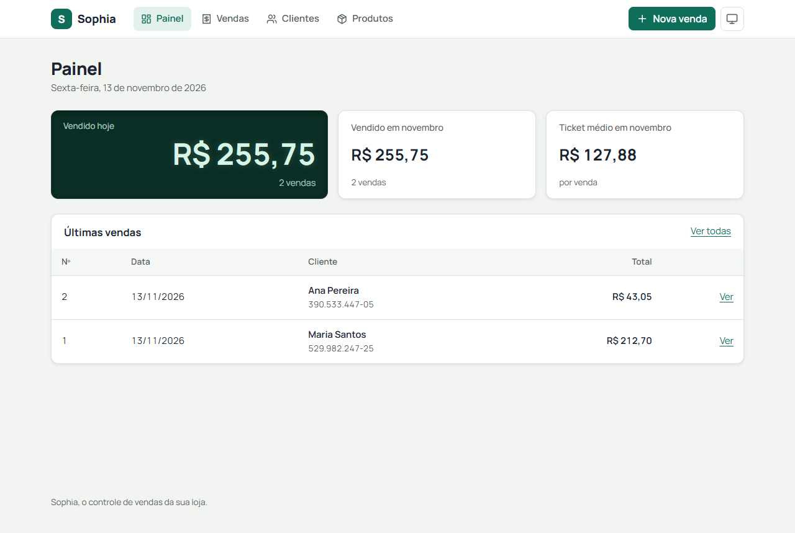
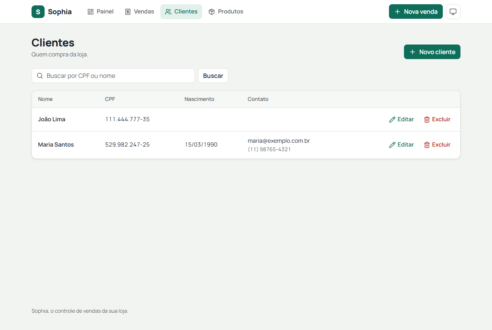
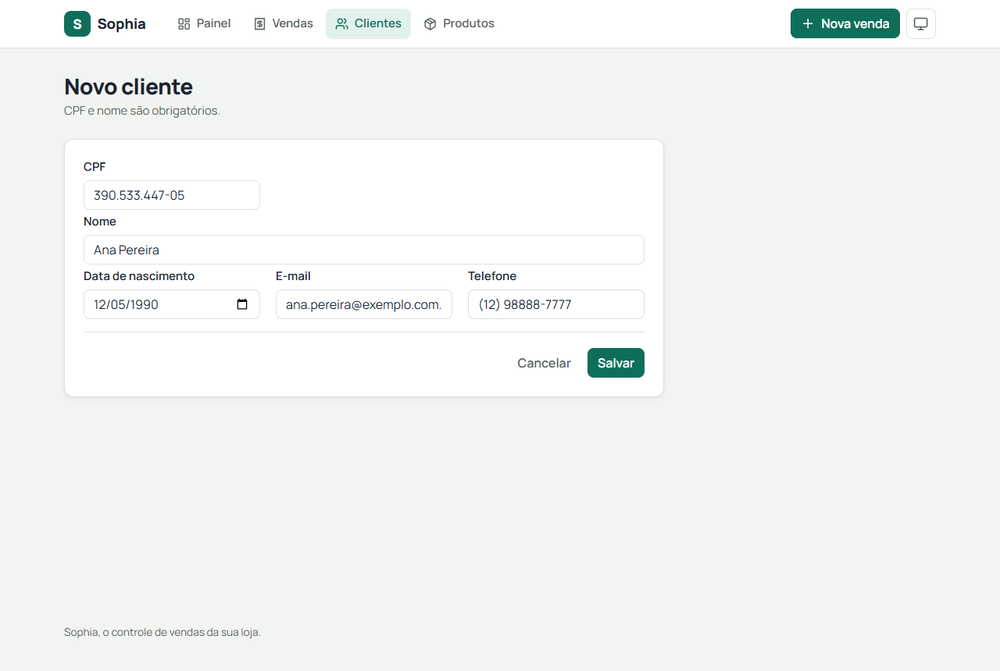
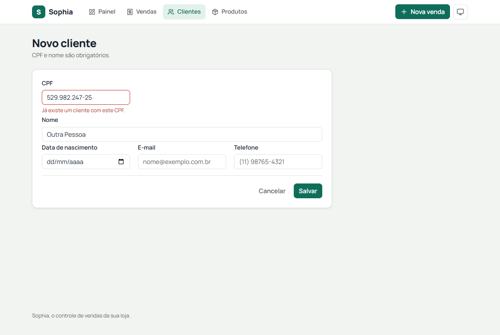
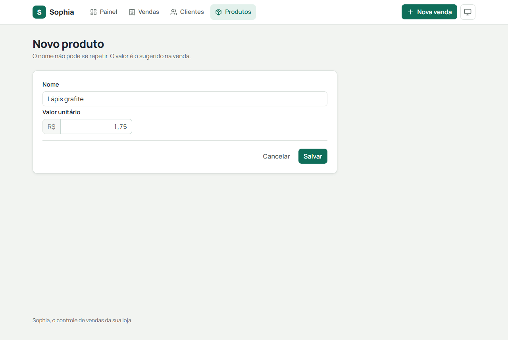
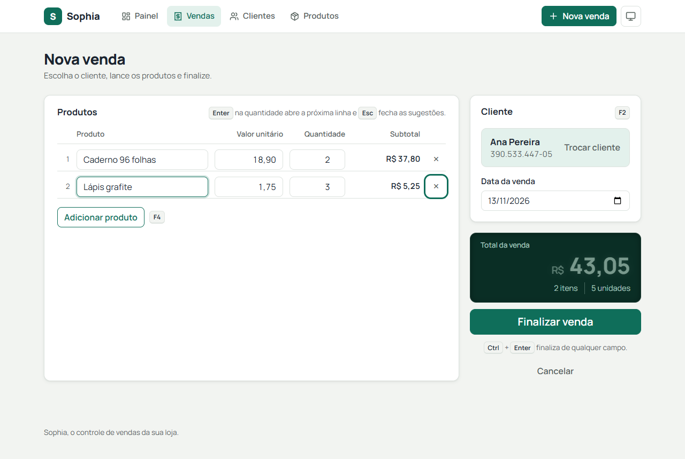
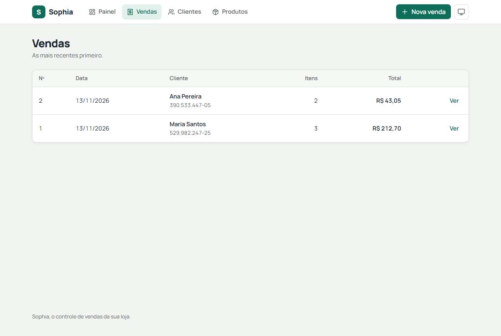

# Guia do usuário

Este guia é para quem opera o Sophia no dia a dia: cadastrar clientes e produtos e registrar
vendas no caixa. Para instalar e subir a aplicação, veja [Como executar](../README.md#como-executar).

- [1. Visão geral](#1-visão-geral)
- [2. Painel](#2-painel)
- [3. Clientes](#3-clientes)
- [4. Produtos](#4-produtos)
- [5. Registrar uma venda](#5-registrar-uma-venda)
- [6. Consultar vendas](#6-consultar-vendas)
- [7. Tema claro e escuro](#7-tema-claro-e-escuro)
- [8. Atalhos de teclado](#8-atalhos-de-teclado)
- [9. Mensagens e o que fazer](#9-mensagens-e-o-que-fazer)

## 1. Visão geral

O menu do topo leva às quatro áreas do sistema:

| Menu | Para que serve |
|---|---|
| **Painel** | resumo do dia e do mês e as últimas vendas |
| **Vendas** | lista de vendas registradas e o detalhe de cada uma |
| **Clientes** | quem compra da loja |
| **Produtos** | o que a loja vende e por quanto |

O botão **Nova venda**, no canto direito, abre o caixa de qualquer tela.

A ordem natural para começar é: cadastrar os clientes, cadastrar os produtos e só então
registrar as vendas.

## 2. Painel

É a tela inicial. Mostra:

- **Vendido hoje**: o total vendido no dia e a quantidade de vendas;
- **Vendido no mês** e **ticket médio** (o valor médio de cada venda no mês);
- **Últimas vendas**: as mais recentes, com o link **Ver** para o detalhe e **Ver todas**
  para a lista completa.

## 3. Clientes

A lista mostra todos os clientes. Use a busca para encontrar pelo **CPF** ou pelo **nome**;
**Limpar a busca** volta à lista completa.

### Cadastrar um cliente

1. Clique em **Novo cliente**.
2. Preencha os campos:

   | Campo | Obrigatório | Observação |
   |---|---|---|
   | CPF | sim | digite só os números; a máscara `000.000.000-00` entra sozinha. O CPF precisa ser válido e não pode estar cadastrado para outro cliente |
   | Nome | sim | até 150 caracteres |
   | Data de nascimento | não | não pode ser uma data futura |
   | E-mail | não | precisa ter um formato válido, como `nome@exemplo.com.br` |
   | Telefone | não | com DDD; a máscara entra sozinha |

3. Clique em **Salvar**. O aviso **Cliente cadastrado.** confirma a gravação.

Se o CPF já pertence a outro cliente, o sistema não grava e avisa no próprio campo:

### Alterar ou excluir

Na lista, use **Editar** ou **Excluir** na linha do cliente. A exclusão pede confirmação e
não pode ser desfeita. **Um cliente que já tem vendas não pode ser excluído**, para não
apagar o histórico.

## 4. Produtos

Funciona como o cadastro de clientes, com dois campos:

| Campo | Obrigatório | Observação |
|---|---|---|
| Nome | sim | não pode se repetir |
| Valor unitário | sim | maior que zero, com até duas casas decimais (use vírgula: `1,75`) |

O valor unitário é o preço **sugerido** no caixa: na venda ele pode ser ajustado. Mudar o
preço de um produto depois **não altera** as vendas já registradas.

**Um produto que já foi vendido não pode ser excluído.**

## 5. Registrar uma venda

A tela de venda foi pensada para ser operada só pelo teclado, como um caixa.

### Passo a passo

1. Clique em **Nova venda** (no topo de qualquer tela).
2. **Escolha o cliente** (atalho `F2`): digite parte do **CPF** ou do **nome**. As sugestões
   aparecem logo abaixo; use as setas para escolher e `Enter` para confirmar. O nome e o CPF
   do cliente escolhido ficam no quadro **Cliente**. Para mudar, use **Trocar cliente**.

   

3. Confira a **Data da venda**. Ela já vem com a data de hoje e não aceita data futura.
4. **Lance os produtos** (atalho `F4` ou o botão **Adicionar produto**):
   - digite parte do nome do produto e escolha na lista com `Enter`;
   - o **valor unitário** vem preenchido com o preço do cadastro e pode ser ajustado;
   - informe a **quantidade** e pressione `Enter`: o sistema abre a próxima linha para o
     próximo produto.
5. Acompanhe os totais:
   - o **subtotal** de cada linha (quantidade × valor unitário);
   - o **Total da venda** no visor verde, com o número de itens e de unidades.
6. Para tirar um produto, use o **×** no fim da linha.
7. Clique em **Finalizar venda** ou pressione `Ctrl` + `Enter` (funciona com o cursor em
   qualquer campo).

Linhas deixadas em branco são descartadas ao finalizar. Se faltar algo, a venda não é
gravada e a mensagem aparece no campo que precisa de correção; o que já foi digitado
continua na tela.

O mesmo produto não pode aparecer em duas linhas da mesma venda: aumente a quantidade na
linha que já existe.

**Cancelar** sai da tela sem gravar nada.

### Depois de finalizar

O sistema mostra o detalhe da venda com o aviso **Venda registrada.**: número da venda,
data, cliente (nome e CPF), cada produto com quantidade, valor unitário e subtotal, e o
total da venda.

- **Imprimir** gera uma versão da venda própria para papel;
- o botão **Nova venda**, no topo, abre o caixa vazio para o próximo cliente.

Os totais são sempre recalculados pelo sistema na gravação: o que fica registrado é a conta
feita a partir dos itens.

## 6. Consultar vendas

O menu **Vendas** lista as vendas, das mais recentes para as mais antigas, com número, data,
cliente e total. **Ver** abre o detalhe.

Vendas registradas não são alteradas nem excluídas: são o histórico da loja.

## 7. Tema claro e escuro

O botão ao lado de **Nova venda**, no topo, escolhe a aparência:

- **Claro**;
- **Escuro**;
- **Automático**: acompanha a configuração do computador.

A escolha fica guardada neste navegador.

## 8. Atalhos de teclado

Valem na tela de venda:

| Tecla | O que faz |
|---|---|
| `F2` | vai para a busca de cliente (ou troca o cliente escolhido) |
| `F4` | vai para o próximo produto em branco, abrindo uma linha se precisar |
| `↑` `↓` | navegam pelas sugestões de cliente ou de produto |
| `Enter` | confirma a sugestão; na quantidade, abre a próxima linha |
| `Esc` | fecha as sugestões |
| `Ctrl` + `Enter` | finaliza a venda |

## 9. Mensagens e o que fazer

| Mensagem | O que significa | O que fazer |
|---|---|---|
| Informe o CPF. / Informe o nome. | campo obrigatório vazio | preencha o campo |
| CPF inválido. | os dígitos verificadores não conferem | confira o número com o documento |
| Já existe um cliente com este CPF. | o CPF já está cadastrado | busque o cliente na lista em vez de cadastrar de novo |
| Já existe um produto com este nome. | o nome já está em uso | use o produto existente ou um nome diferente |
| Este cliente possui vendas e não pode ser excluído. | o cliente tem histórico | mantenha o cadastro; corrija os dados com **Editar** |
| Este produto já foi vendido e não pode ser excluído. | o produto tem histórico | mantenha o cadastro; ajuste o preço com **Editar** |
| Selecione o cliente. | a venda está sem cliente | use `F2` e escolha o cliente |
| Lance ao menos um produto na venda. | nenhum item preenchido | use `F4` e lance um produto |
| Selecione o produto. | a linha tem valor ou quantidade, mas não tem produto | escolha o produto na lista de sugestões |
| A quantidade deve ser maior que zero. | quantidade zero ou vazia | informe a quantidade |
| Este produto já foi lançado nesta venda; ajuste a quantidade na linha anterior. | produto repetido | remova a linha e some a quantidade na primeira |
| A data da venda não pode estar no futuro. | data depois de hoje | corrija a data |
| Não foi possível concluir a operação. Tente de novo em instantes. | falha inesperada | tente de novo; se persistir, avise o responsável pelo sistema |
